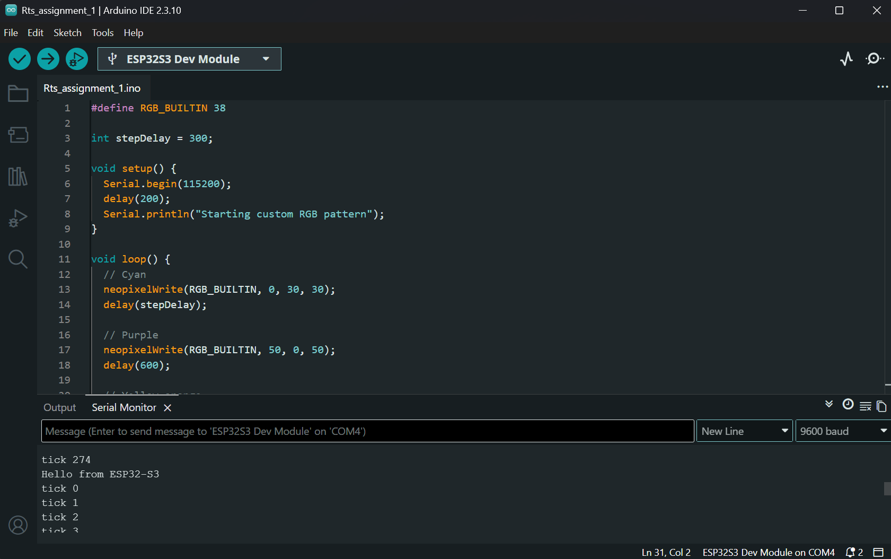

# Assignment 1: ESP32-S3 RGB LED

## Setup & Serial Check
Installed the ESP32 board package in Arduino IDE, picked ESP32S3 Dev Module on COM4, and tested the serial monitor at 115200 baud. It printed "Hello from ESP32-S3" and started counting up ticks every 500 ms.

## Tasks

### Task A: Change the Colour
- **What I changed:** Changed the RGB values in `neopixelWrite()` from `(50, 0, 0)` to `(0, 50, 0)`, `(0, 0, 50)`, and `(50, 50, 50)`.
- **What happened:** The LED switched to green, blue, and white. Setting all three to 50 mixed them into white light, which also looked a bit brighter than the single colours.

### Task B: Change the Blink Rate
- **What I changed:** Changed both `delay(1000)` lines to `delay(250)`.
- **What happened:** The LED blinked 4 times faster, doing a full on/off cycle every 0.5 seconds instead of 2 seconds.

### Task C: Create an RGB Cycle
- **What I changed:** Put four `neopixelWrite()` calls in a row (Red, Green, Blue, Off) with `delay(500)` after each one.
- **What happened:** The LED cycled through red, green, blue, and off for half a second each, repeating every 2 seconds.

### Task D: Create Your Own Pattern
- **What I changed:** Made a custom 5-step pattern in `ESP32_RGB_Lab.ino` using cyan, purple, yellow-orange, a quick red flash, and off, with different brightness values (30 to 70) and delays (150 ms to 800 ms).
- **What happened:** The LED ran through a varied sequence of mixed colours and brightness levels instead of a plain single-colour blink.
