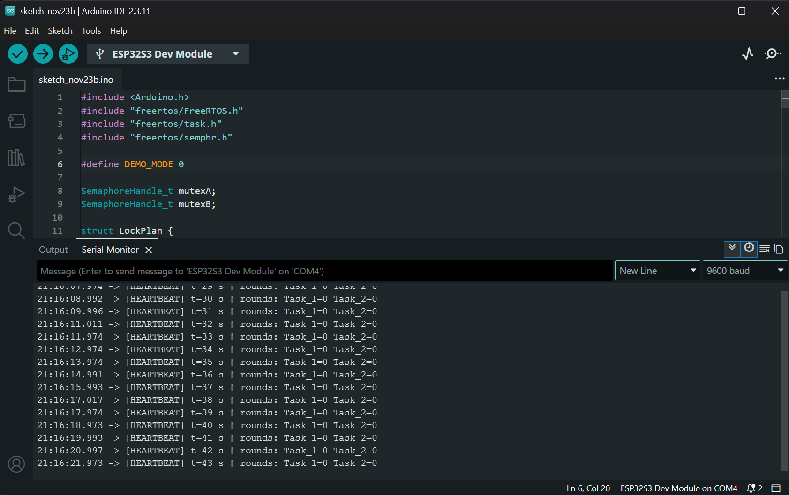
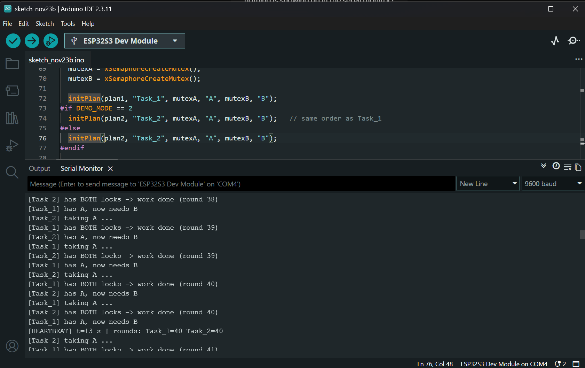

# Assignment 10A: Preventing Deadlock in FreeRTOS

Tested `Demo1_Deadlock.ino` on an ESP32-S3-DevKitC-1 v1.1 over USB on COM4 at 115200 baud to observe a circular wait deadlock and fix it using a consistent lock order.

## Part A – Understanding the Problem

1. **Which two tasks can cause a deadlock?**
   `Task_Sensor` and `Task_Logger` can cause a deadlock because they acquire the two mutexes in opposite order. If `Task_Sensor` locks `i2cMutex` and gets preempted before locking `uartMutex`, and `Task_Logger` locks `uartMutex` at the same time, both tasks end up blocked forever waiting for the mutex the other task is holding.

2. **Can `Task_Display` create a circular wait by itself?**
   No. `Task_Display` only acquires `i2cMutex` and never tries to lock a second mutex while holding it, so it cannot form a circular waiting chain.

3. **Which Coffman condition is removed when all tasks acquire mutexes in the same order?**
   Circular Wait.

---

## Part B – ESP32 Experiment and Results

### Step 1



Serial Monitor output:

```text
[HEARTBEAT] t=30 s | rounds: Task_1=0 Task_2=0
[HEARTBEAT] t=31 s | rounds: Task_1=0 Task_2=0
[HEARTBEAT] t=32 s | rounds: Task_1=0 Task_2=0
[HEARTBEAT] t=33 s | rounds: Task_1=0 Task_2=0
[HEARTBEAT] t=34 s | rounds: Task_1=0 Task_2=0
[HEARTBEAT] t=35 s | rounds: Task_1=0 Task_2=0
[HEARTBEAT] t=36 s | rounds: Task_1=0 Task_2=0
[HEARTBEAT] t=37 s | rounds: Task_1=0 Task_2=0
```

* Both worker tasks freeze permanently (`Task_1` holds `A` waiting for `B`, `Task_2` holds `B` waiting for `A`), so `Task_1=0` and `Task_2=0` stop incrementing while only `t` keeps counting up.

### Step 2



Serial Monitor output:

```text
[Task_2] has BOTH locks -> work done (round 38)[cite: 1]
[Task_1] has A, now needs B[cite: 1]
[Task_2] taking A ...[cite: 1]
[Task_1] has BOTH locks -> work done (round 39)[cite: 1]
[Task_2] has A, now needs B[cite: 1]
[Task_1] taking A ...[cite: 1]
[Task_2] has BOTH locks -> work done (round 39)[cite: 1]
[HEARTBEAT] t=13 s | rounds: Task_1=40 Task_2=40[cite: 1]
```

* Changing `plan2` to acquire `mutexA` before `mutexB` ensures whichever task gets `mutexA` first can always acquire `mutexB` and finish its work without circular waiting[cite: 1].

### Step 3 (`DEMO_MODE 1` – Timeout and Backoff)

* When `xSemaphoreTake` times out on the second mutex, the task releases its first mutex so the other task can proceed, and waits a random backoff delay before retrying so both tasks do not collide again (preventing livelock).

---

## What I Learned

I learned that locking shared mutexes in opposite orders causes a circular wait deadlock that freezes worker tasks completely. Enforcing a consistent global lock order (`mutexA` then `mutexB`) across all tasks eliminates circular wait cleanly.