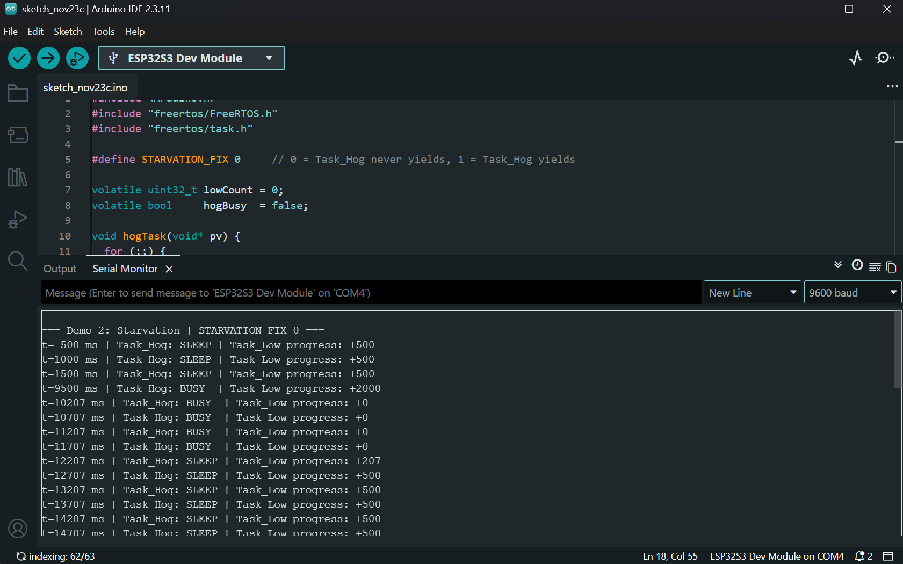
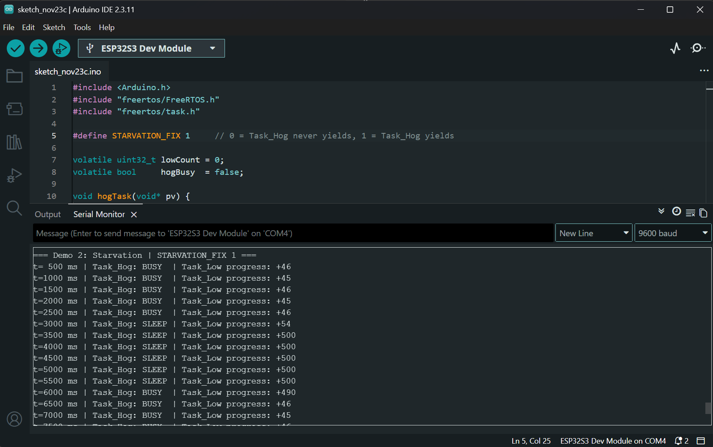
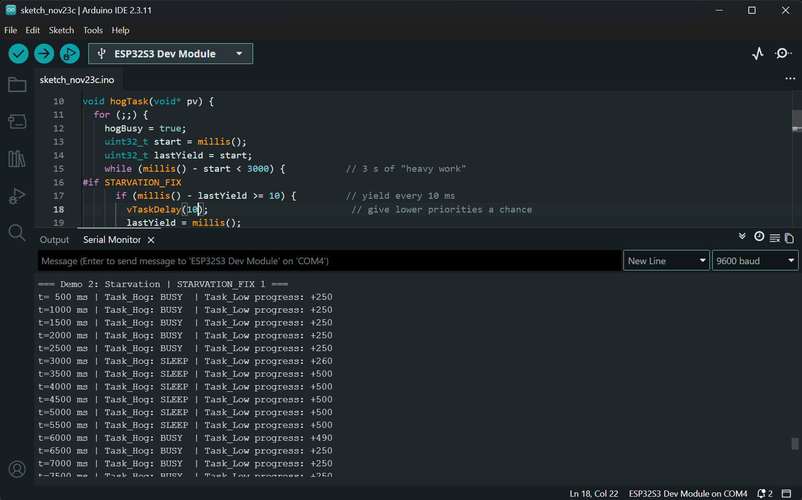

# Assignment 10B: Preventing Starvation in FreeRTOS

Tested `Demo2_Starvation.ino` on an ESP32-S3-DevKitC-1 v1.1 over USB on COM4 at 115200 baud to observe priority starvation and fix it by allowing the higher-priority task to block periodically[cite: 2, 3, 4].

## Part A – Understanding the Problem

1. **Which tasks may experience starvation? Explain why.**
   `Task_Display` (priority 2) and `Task_Log` (priority 1) will both experience starvation. Because FreeRTOS always schedules the highest-priority Ready task and `Task_Control` (priority 3) runs continuously without blocking, `Task_Control` keeps 100% of the CPU time and neither lower-priority task gets to run.

2. **Why is it dangerous for a high-priority task to run continuously without blocking?**
   Besides starving lower-priority tasks so the display and logging freeze completely, it also starves the FreeRTOS Idle task (priority 0), which can trigger the Task Watchdog Timer (TWDT) to reset the microcontroller and prevents cleanup of deleted tasks.

3. **Give two ways to allow lower-priority tasks to get CPU time without changing task priorities.**
   * Call `vTaskDelay()` or `vTaskDelayUntil()` inside the high-priority task loop so it enters the Blocked state periodically.
   * Wait on an event or synchronization primitive (such as a semaphore, mutex, or queue receive) instead of polling continuously.

---

## Part B – ESP32 Experiment and Results

### Step 1



Serial Monitor output:

```text
=== Demo 2: Starvation | STARVATION_FIX 0 ===
t= 500 ms | Task_Hog: SLEEP | Task_Low progress: +500
t=1000 ms | Task_Hog: SLEEP | Task_Low progress: +500
t=1500 ms | Task_Hog: SLEEP | Task_Low progress: +500
t=10207 ms | Task_Hog: BUSY  | Task_Low progress: +0
t=10707 ms | Task_Hog: BUSY  | Task_Low progress: +0
t=11207 ms | Task_Hog: BUSY  | Task_Low progress: +0
t=11707 ms | Task_Hog: BUSY  | Task_Low progress: +0
t=12707 ms | Task_Hog: SLEEP | Task_Low progress: +500
```

* While `Task_Hog` is `BUSY`, `Task_Low` progress is `+0`; while `Task_Hog` is `SLEEP`, `Task_Low` progresses at `+500` per 500 ms[cite: 2]. This shows that a higher-priority task that never blocks completely starves lower-priority tasks on the same core[cite: 2].

### Step 2



Serial Monitor output:

```text
=== Demo 2: Starvation | STARVATION_FIX 1 ===
t= 500 ms | Task_Hog: BUSY  | Task_Low progress: +46
t=1000 ms | Task_Hog: BUSY  | Task_Low progress: +45
t=1500 ms | Task_Hog: BUSY  | Task_Low progress: +46
t=2000 ms | Task_Hog: BUSY  | Task_Low progress: +45
t=2500 ms | Task_Hog: BUSY  | Task_Low progress: +46
t=3500 ms | Task_Hog: SLEEP | Task_Low progress: +500
t=4000 ms | Task_Hog: SLEEP | Task_Low progress: +500
```

* Compared to `+0` in Step 1[cite: 2], `Task_Low` now makes `+45` to `+46` progress every 500 ms during `BUSY`[cite: 3] because `Task_Hog` calls `vTaskDelay(1)` every 10 ms, entering the Blocked state for 1 tick so `Task_Low` can run.

### Step 3



Serial Monitor output:

```text
=== Demo 2: Starvation | STARVATION_FIX 1 ===
t= 500 ms | Task_Hog: BUSY  | Task_Low progress: +250
t=1000 ms | Task_Hog: BUSY  | Task_Low progress: +250
t=1500 ms | Task_Hog: BUSY  | Task_Low progress: +250
t=2000 ms | Task_Hog: BUSY  | Task_Low progress: +250
t=2500 ms | Task_Hog: BUSY  | Task_Low progress: +250
t=3500 ms | Task_Hog: SLEEP | Task_Low progress: +500
```

* **Prediction:** Increasing `vTaskDelay(1)` to `vTaskDelay(10)` will block `Task_Hog` for 10 ticks (10 ms) after every 10 ms of work, giving `Task_Low` about half the CPU time (`~+250` per 500 ms).
* **Result:** `Task_Low` progress jumped from `+46` to `+250` per 500 ms during `BUSY`[cite: 3, 4] because `vTaskDelay()` counts in RTOS ticks (1 ms/tick), splitting CPU time 50/50 between both tasks.

---

## What I Learned

I learned that a high-priority task that never blocks completely starves lower-priority tasks on the same core[cite: 2]. Calling `vTaskDelay()` puts the high-priority task into the Blocked state so lower-priority tasks get CPU time, and increasing the delay ticks increases their share of CPU time[cite: 3, 4].