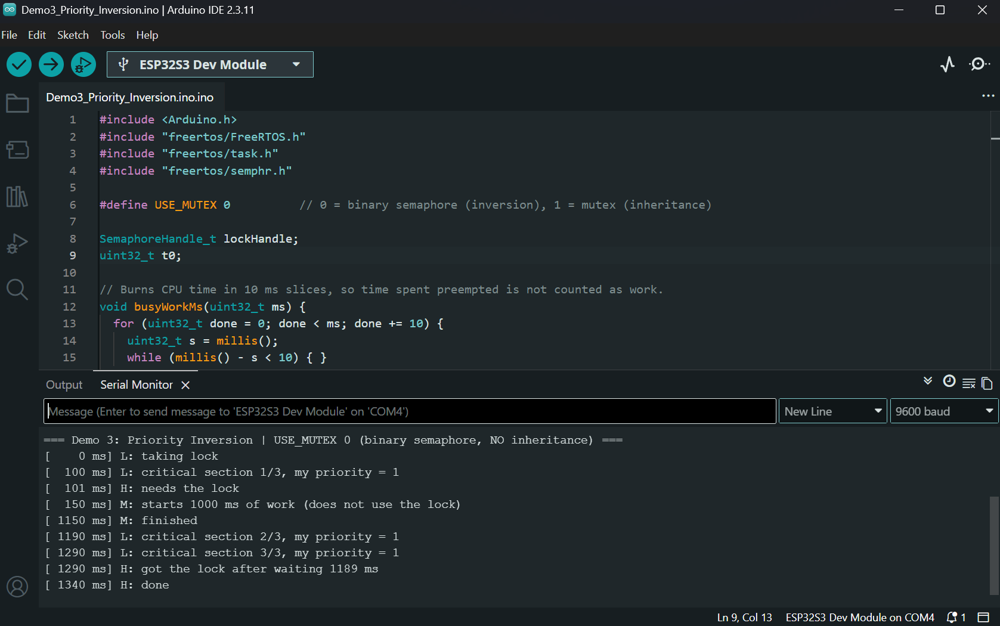
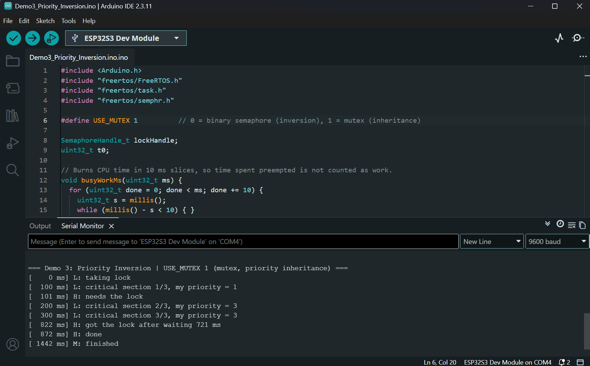
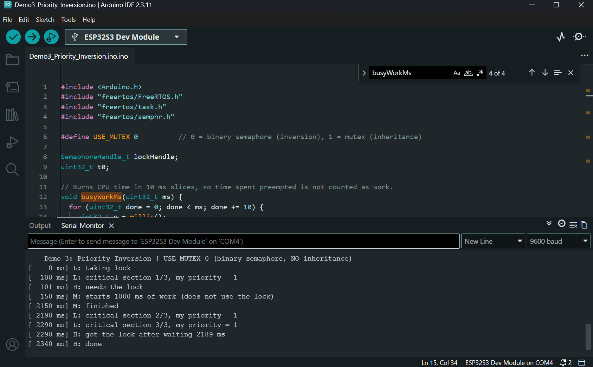
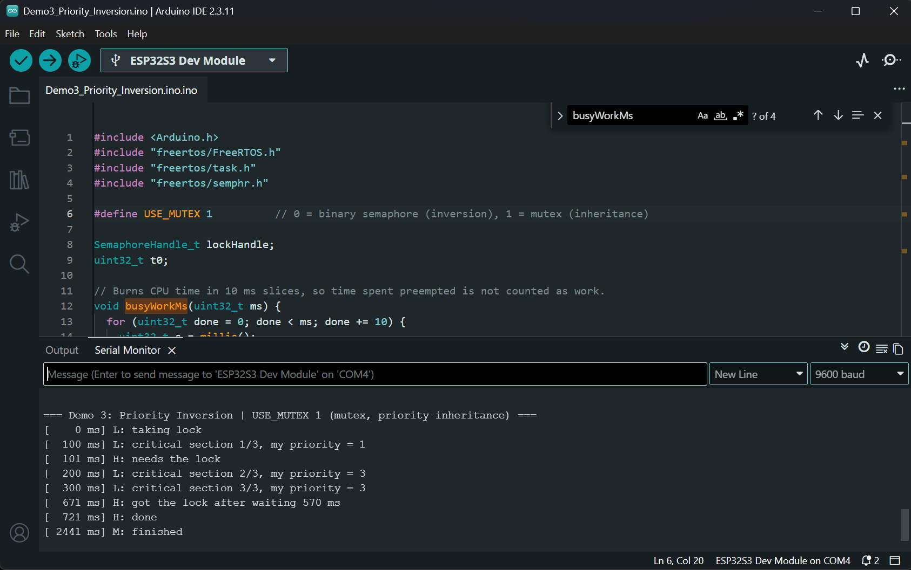

# Assignment 11: Priority Inversion and Priority Inheritance (`Demo3_Priority_Inversion.ino`)

---

## Part A – Predict the Behaviour

1. **With a binary semaphore, what happens after Task_H requests the lock? Explain how Task_M affects Task_L.**
   When Task_H (priority 3) wakes up at ~100 ms and calls xSemaphoreTake(), the lock is already held by Task_L (priority 1), so Task_H enters the Blocked state and Task_L resumes running at priority 1. When Task_M (priority 2) wakes up at ~150 ms, it has higher priority than Task_L (2 > 1) and preempts Task_L. Because Task_M runs continuously for 1000 ms without needing the lock, it starves Task_L of CPU time and indirectly forces Task_H to wait until Task_M finishes and Task_L finally completes its remaining work and releases the lock.

2. **Timeline – Binary Semaphore (USE_MUTEX 0):**
   ```text
   0 ms        100 ms      150 ms                      1150 ms     1350 ms     1400 ms
   |-----------|-----------|---------------------------|-----------|-----------|
   [  Task_L   ]           [          Task_M           ][  Task_L   ][  Task_H   ]
    (holds lock)  (H blocks) (preempts L for 1000 ms)    (finishes &  (gets lock
                                                          gives lock)  & finishes)
   ```

3. **What changes when a mutex with priority inheritance is used? Timeline (USE_MUTEX 1):**
   When Task_H (priority 3) blocks waiting for the mutex held by Task_L (priority 1), FreeRTOS temporarily boosts Task_L's priority to match Task_H (priority 3). Because Task_L now runs at priority 3, Task_M (priority 2) cannot preempt Task_L at 150 ms. Task_L finishes its critical section quickly, releases the mutex (returning to priority 1), Task_H runs immediately, and Task_M runs last.

   ```text
   0 ms        100 ms                  300 ms      350 ms                      1350 ms
   |-----------|-----------------------|-----------|---------------------------|
   [  Task_L   ][  Task_L (prio 3)    ][  Task_H   ][          Task_M           ]
    (prio 1)     (inherits prio 3;      (gets lock  (runs after H finishes)
                  M cannot preempt)      & finishes)
   ```

4. **Which task temporarily inherits a higher priority? What priority does it inherit?**
   Task_L temporarily inherits priority 3 (the priority of Task_H).

---

## Part B – ESP32 Experiment and Measurements

### Step 1 – Binary Semaphore (USE_MUTEX 0, busyWorkMs(1000))



Serial Monitor output:
```text
=== Demo 3: Priority Inversion | USE_MUTEX 0 (binary semaphore, NO inheritance) ===
[    0 ms] L: taking lock
[  100 ms] L: critical section 1/3, my priority = 1
[  101 ms] H: needs the lock
[  150 ms] M: starts 1000 ms of work (does not use the lock)
[ 1150 ms] M: finished
[ 1190 ms] L: critical section 2/3, my priority = 1
[ 1290 ms] L: critical section 3/3, my priority = 1
[ 1290 ms] H: got the lock after waiting 1189 ms
[ 1340 ms] H: done
```

- **Task_H waiting time:** 1189 ms
- **Task_L printed priority:** 1 (across all 3 sections)
- **Completion order:** Task_M → Task_L → Task_H

---

### Step 2 – Mutex with Priority Inheritance (USE_MUTEX 1, busyWorkMs(1000))



Serial Monitor output:
```text
=== Demo 3: Priority Inversion | USE_MUTEX 1 (mutex, priority inheritance) ===
[    0 ms] L: taking lock
[  100 ms] L: critical section 1/3, my priority = 1
[  101 ms] H: needs the lock
[  200 ms] L: critical section 2/3, my priority = 3
[  300 ms] L: critical section 3/3, my priority = 3
[  822 ms] H: got the lock after waiting 721 ms
[  872 ms] H: done
[ 1442 ms] M: finished
```

- **Task_H waiting time:** 721 ms
- **Task_L printed priority:** 1 in section 1/3, then 3 in sections 2/3 and 3/3
- **Completion order:** Task_L → Task_H → Task_M

#### Comparison Table (busyWorkMs(1000))

| Observation | Binary semaphore (USE_MUTEX 0) | Mutex (USE_MUTEX 1) |
| :--- | :--- | :--- |
| **Task_H waiting time** | 1189 ms | 721 ms |
| **Task_L printed priority** | 1 | 1 (before H blocks) → 3 (while H waits) |
| **Does Task_M delay Task_L?** | Yes (M preempts L for 1000 ms) | No (L finishes before M starts) |
| **Does priority inheritance occur?** | No | Yes (L inherits priority 3) |

- **Comparison with Part A predictions:** The measurements confirm Part A: with the binary semaphore, Task_L stayed at priority 1, Task_M preempted it for 1000 ms, and Task_H waited 1189 ms. With the mutex, Task_L inherited priority 3 as soon as Task_H blocked, preventing Task_M from preempting Task_L so Task_H finished before Task_M even ran.

---

### Step 3 – Increased Workload (busyWorkMs(2000))

- **Prediction before changing the code:** Doubling Task_M's workload from 1000 ms to 2000 ms will add ~1000 ms directly onto Task_H's waiting time in the binary semaphore configuration (USE_MUTEX 0, rising from ~1189 ms to ~2189 ms) because Task_M preempts Task_L for twice as long. With the mutex (USE_MUTEX 1), Task_M cannot preempt Task_L, so doubling Task_M's workload will not add the extra 1000 ms to Task_H's wait.

#### Test 3 – Binary Semaphore (USE_MUTEX 0, busyWorkMs(2000))



```text
=== Demo 3: Priority Inversion | USE_MUTEX 0 (binary semaphore, NO inheritance) ===
[    0 ms] L: taking lock
[  100 ms] L: critical section 1/3, my priority = 1
[  101 ms] H: needs the lock
[  150 ms] M: starts 1000 ms of work (does not use the lock)
[ 2150 ms] M: finished
[ 2190 ms] L: critical section 2/3, my priority = 1
[ 2290 ms] L: critical section 3/3, my priority = 1
[ 2290 ms] H: got the lock after waiting 2189 ms
[ 2340 ms] H: done
```

#### Test 4 – Mutex (USE_MUTEX 1, busyWorkMs(2000))



```text
=== Demo 3: Priority Inversion | USE_MUTEX 1 (mutex, priority inheritance) ===
[    0 ms] L: taking lock
[  100 ms] L: critical section 1/3, my priority = 1
[  101 ms] H: needs the lock
[  200 ms] L: critical section 2/3, my priority = 3
[  300 ms] L: critical section 3/3, my priority = 3
[  671 ms] H: got the lock after waiting 570 ms
[  721 ms] H: done
[ 2441 ms] M: finished
```

- **Results & explanation:** With USE_MUTEX 0, Task_H's waiting time increased by exactly 1000 ms—from 1189 ms to 2189 ms—matching the prediction. With USE_MUTEX 1, Task_H only waited 570 ms and finished at 721 ms, long before Task_M finished at 2441 ms. Increasing Task_M's workload affects the two configurations differently because without priority inheritance (USE_MUTEX 0), Task_M (priority 2) preempts Task_L (priority 1) and delays Task_H by Task_M's entire runtime, whereas with priority inheritance (USE_MUTEX 1), Task_L runs at priority 3 until it releases the mutex, so Task_M never runs until Task_H is completely done.

---

## Part C – Explain What You Observed

1. **Why does Task_H wait longer when a binary semaphore is used?**
   When a binary semaphore is used, Task_L keeps its base priority of 1 even after Task_H blocks waiting for the lock. Because Task_M has priority 2, it can preempt Task_L as soon as Task_M wakes up, forcing Task_H to wait for both Task_M's full execution and Task_L's remaining critical section.

2. **Explain how Task_L inherits the priority of Task_H when a mutex is used.**
   Because a FreeRTOS mutex tracks task ownership, when Task_H (priority 3) calls xSemaphoreTake() on a mutex currently owned by Task_L (priority 1), the scheduler automatically raises Task_L's active priority to 3 until Task_L calls xSemaphoreGive(), at which point Task_L returns to its original priority.

3. **Why can Task_M no longer preempt Task_L while Task_L has inherited priority 3?**
   FreeRTOS always runs the highest-priority Ready task on the core. Because Task_L temporarily inherits priority 3 while holding the mutex, its effective priority is higher than Task_M's priority 2, so Task_M cannot preempt Task_L.

4. **What is the main difference between a binary semaphore and a mutex in this demonstration?**
   A binary semaphore has no concept of task ownership and does not change task priorities, allowing Task_M (priority 2) to preempt Task_L (priority 1) and cause unbounded priority inversion. A mutex enforces ownership and priority inheritance, temporarily raising Task_L's priority to 3 so Task_M cannot preempt it while Task_H is waiting.