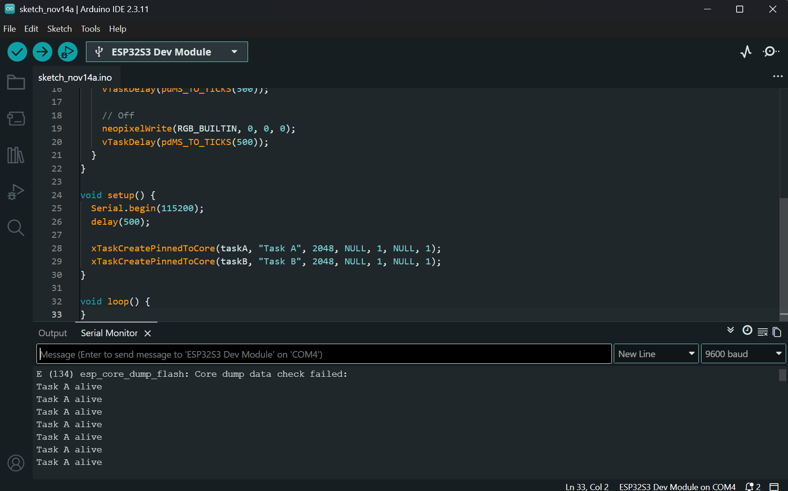

# Assignment 2: FreeRTOS Tasks & Priorities

Used an ESP32-S3-DevKitC-1 v1.1 with the onboard RGB LED on GPIO 38 (set to blue, brightness 45) in Arduino IDE 2.x at 115200 baud.

## Baseline Implementation
Created two FreeRTOS tasks pinned to Core 1, both starting at priority 1. Task A prints `"Task A alive"` to the serial monitor every 1000 ms using `vTaskDelay(pdMS_TO_TICKS(1000))`. Task B blinks the onboard blue LED (500 ms on, 500 ms off) using `vTaskDelay(pdMS_TO_TICKS(500))`.

## Prediction and Observation Table

| Scenario | Prediction before test | Actual observation | Did it match? Why? |
| :--- | :--- | :--- | :--- |
| **A. Both tasks at priority 1** | Both tasks will run fine on time since they spend most of their time waiting in `vTaskDelay()`. | `"Task A alive"` printed every 1000 ms and the blue LED blinked every 500 ms. | Yes, neither task uses much CPU time before blocking so they share Core 1 easily. |
| **B. Task A priority 2; Task B priority 1** | Task A will go first if they wake up at the exact same tick, but both should still run at their normal 1000 ms and 500 ms rates. | Looked the same as the baseline. `"Task A alive"` printed every 1000 ms and the LED kept blinking every 500 ms. | Yes, Task A blocks for 1000 ms right after printing, which gives Task B plenty of time to run. |
| **C. Task A priority 1; Task B priority 2** | Task B will have priority when changing the LED, while Task A will still print every 1000 ms normally. | Both tasks still ran at their normal 500 ms and 1000 ms speeds with no visible change. | Yes, Task B blocks for 500 ms after every LED toggle, leaving the CPU free for Task A. |

## Priority Experiments
Tested all three priority setups (`1/1`, `2/1`, and `1/2`) on Core 1 while keeping all `vTaskDelay()` calls active:
- Both tasks kept running properly in every test.
- The timing periods (1000 ms for Task A and 500 ms for Task B) stayed the same as the baseline.
- Giving a periodic task a higher priority does not make it run more often because its repeat rate is controlled by `vTaskDelay()`. Once the higher-priority task finishes its quick job and hits `vTaskDelay()`, it moves to the Blocked state and lets the lower-priority task run normally.

## Starvation Experiment
- **What I changed:** Set Task A to priority 2 and Task B to priority 1 on Core 1, then commented out `vTaskDelay(pdMS_TO_TICKS(1000))` inside Task A.
- **What happened:** The Serial Monitor started spamming `"Task A alive"` non-stop, and the onboard blue LED froze and stopped blinking.
- **Restored check:** Right after checking this, I uncommented `vTaskDelay(pdMS_TO_TICKS(1000))` in Task A, set the priorities back to 1, and confirmed both tasks worked normally again.

## Ready, Running and Blocked Explanation
When a task is actively running its code on Core 1, like Task A printing `"Task A alive"` or Task B calling `neopixelWrite()`, it is in the **Running** state. When that task calls `vTaskDelay(pdMS_TO_TICKS(...))`, FreeRTOS moves it into the **Blocked** state until the delay timer runs out so it does not waste CPU cycles waiting. Once the delay finishes, the task moves back to the **Ready** state. The FreeRTOS scheduler always picks the highest-priority **Ready** task to become **Running** on Core 1. During my normal priority tests (`2/1` and `1/2`), changing priorities did not visibly change the serial prints or the LED blink speed because both tasks spent almost all their time in the **Blocked** state, leaving Core 1 free whenever the other task became **Ready**. However, when I removed `vTaskDelay()` from higher-priority Task A during the starvation test, Task A never entered the **Blocked** state. It stayed **Running** (or **Ready** right after a tick interrupt) nonstop, so the scheduler never gave Core 1 to lower-priority Task B, causing the LED to freeze.

## Final Restored Configuration
- **Board & Pin:** ESP32-S3-DevKitC-1 v1.1, onboard RGB LED on GPIO 38
- **Final Task Priorities:** Task A = Priority 1 (Core 1), Task B = Priority 1 (Core 1)
- **Confirmation:** The starvation test was only temporary, and all `vTaskDelay(pdMS_TO_TICKS(...))` calls have been restored and verified in `RTOS_Mini_Assignment.ino`.