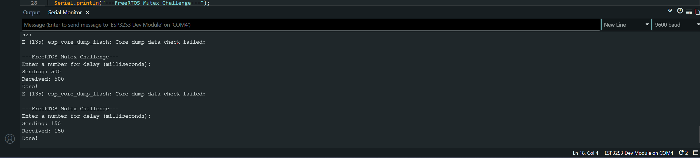

# Assignment 4: Passing Task Parameters Safely with a Mutex

Used an ESP32-S3-DevKitC-1 v1.1 over USB on COM4 in Arduino IDE 2.x at 115200 baud with the onboard RGB LED on GPIO 38 (blue, brightness 45). Updated `delay_arg` in `setup()` to `int` to match `*(int *)parameters` in `blinkLED`, and added a FreeRTOS mutex so `setup()` waits until `blinkLED` copies the parameter before finishing.

## Test Results
Tested two different delay values (`500` ms and `150` ms). In both runs, `Received: <value>` printed before `Done!`, confirming `setup()` waited for `blinkLED` to copy `delay_arg`, and the blue LED blinked at the entered delay rate.

## Questions & Answers

### 1. Why can passing the address of a local variable to a task be unsafe?
A local variable inside `setup()` lives on `setup()`'s stack frame. Once `setup()` finishes executing, that stack memory is freed and can be overwritten by other functions or tasks. If the new task reads the pointer after `setup()` has already exited, it will read garbage or corrupted data instead of the intended delay value.

### 2. When does `blinkLED` copy the parameter?
`blinkLED` copies the parameter right after taking the mutex at the start of the task (`int num = *(int *)parameters;`), and immediately releases the mutex afterward before entering its infinite blink loop.

### 3. How does the mutex make `setup()` wait?
`setup()` creates the mutex and starts `blinkLED` at a higher priority (priority 2 vs `setup()`'s priority 1) on Core 1, so `blinkLED` immediately preempts `setup()` and locks the mutex. When `setup()` then calls `xSemaphoreTake(mutex, portMAX_DELAY)`, it enters the Blocked state and waits until `blinkLED` finishes copying the integer and calls `xSemaphoreGive(mutex)`.

### 4. Why is this described as a demonstration hack? What would be a better design in a real application?
In FreeRTOS, a mutex is meant for mutual exclusion (protecting a shared resource so two tasks do not access it at the same time), not for signaling between tasks, and relying on task priority order to make sure the child task grabs the mutex first is fragile. In a real application, a better design would be using a **binary semaphore** or **task notification** (`xTaskNotifyGive` / `ulTaskNotifyTake`) for synchronization, passing the integer directly by value cast as `(void *)delay_arg`, or sending parameters through a **FreeRTOS queue**.