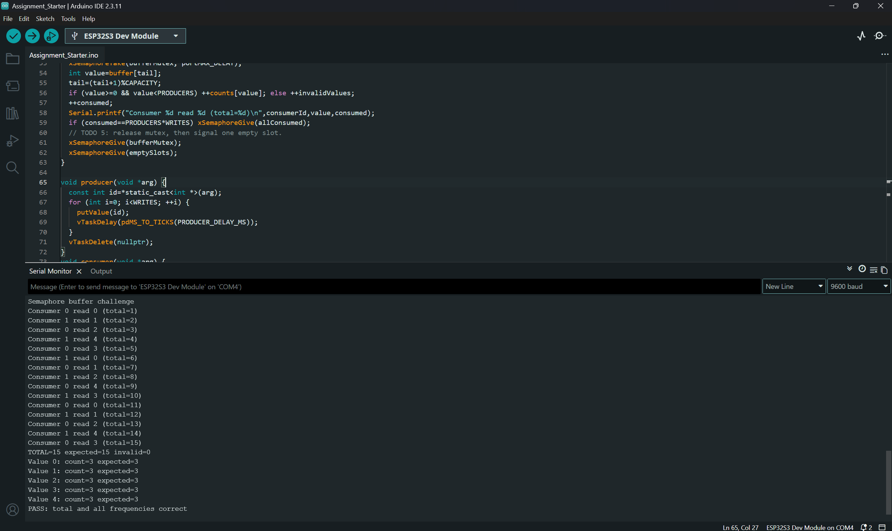
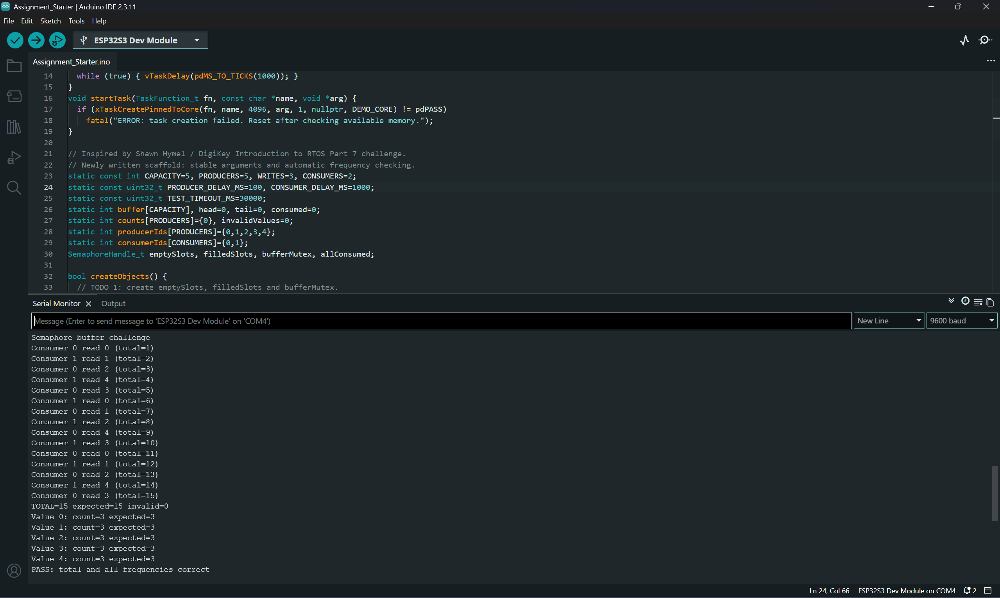

# Assignment 7: Producer–Consumer Buffer with Semaphores and Mutex

## Questions & Answers

1. **What does `emptySlots` count?**
   `emptySlots` counts the number of free places currently available in the circular buffer. It starts at `5` (the buffer capacity) because all 5 slots are initially empty, and producers decrement it with `xSemaphoreTake(emptySlots, portMAX_DELAY)` before writing.

2. **What does `filledSlots` count?**
   `filledSlots` counts the number of written values currently ready to be read from the buffer. It starts at `0` because no data has been produced yet, and consumers decrement it with `xSemaphoreTake(filledSlots, portMAX_DELAY)` before reading.

3. **What does the mutex protect?**
   `bufferMutex` protects the shared circular buffer array (`buffer[]`) and its shared read/write indices (`head` and `tail`) so only one producer or consumer task can modify the buffer state at a time without race conditions.

4. **What did you change in the second test, and what happened?**
   * **Prediction:** Increasing `CONSUMER_DELAY_MS` from `400` ms to `1000` ms makes the consumers read much more slowly than the producers write (`100` ms). Once all 5 buffer slots fill up, the remaining producers block at `xSemaphoreTake(emptySlots, portMAX_DELAY)` until a consumer reads a value and calls `xSemaphoreGive(emptySlots)`, after which all 15 values still get consumed cleanly without data loss.
   * **Observation:** After changing `CONSUMER_DELAY_MS` to `1000`[cite: 7], the program took longer to finish (~7.5 seconds instead of ~3 seconds), and `xSemaphoreTake(emptySlots, portMAX_DELAY)` throttled the producers whenever the 5-slot buffer became full. Even though the Serial Monitor output does not print a separate "waiting" line, blocking on `emptySlots` prevented buffer overwrites and all 15 values (`0`–`4`, 3 times each) were consumed with `PASS: total and all frequencies correct`[cite: 7].

---

## ESP32 Experiment and Serial Monitor Logs

### Test 1 (`CONSUMER_DELAY_MS = 400`)



```text
Semaphore buffer challenge
Consumer 0 read 0 (total=1)
Consumer 1 read 1 (total=2)
Consumer 0 read 2 (total=3)
Consumer 1 read 4 (total=4)
Consumer 0 read 3 (total=5)
Consumer 1 read 0 (total=6)
Consumer 0 read 1 (total=7)
Consumer 1 read 2 (total=8)
Consumer 0 read 4 (total=9)
Consumer 1 read 3 (total=10)
Consumer 0 read 0 (total=11)
Consumer 1 read 1 (total=12)
Consumer 0 read 2 (total=13)
Consumer 1 read 4 (total=14)
Consumer 0 read 3 (total=15)
TOTAL=15 expected=15 invalid=0
Value 0: count=3 expected=3
Value 1: count=3 expected=3
Value 2: count=3 expected=3
Value 3: count=3 expected=3
Value 4: count=3 expected=3
PASS: total and all frequencies correct
```

### Test 2 (`CONSUMER_DELAY_MS = 1000`)



```text
Semaphore buffer challenge
Consumer 0 read 0 (total=1)
Consumer 1 read 1 (total=2)
Consumer 0 read 2 (total=3)
Consumer 1 read 4 (total=4)
Consumer 0 read 3 (total=5)
Consumer 1 read 0 (total=6)
Consumer 0 read 1 (total=7)
Consumer 1 read 2 (total=8)
Consumer 0 read 4 (total=9)
Consumer 1 read 3 (total=10)
Consumer 0 read 0 (total=11)
Consumer 1 read 1 (total=12)
Consumer 0 read 2 (total=13)
Consumer 1 read 4 (total=14)
Consumer 0 read 3 (total=15)
TOTAL=15 expected=15 invalid=0
Value 0: count=3 expected=3
Value 1: count=3 expected=3
Value 2: count=3 expected=3
Value 3: count=3 expected=3
Value 4: count=3 expected=3
PASS: total and all frequencies correct
```

---

## AI Assistance

ChatGPT was used to review the semaphore and mutex acquisition order and verify how blocking behaves when the buffer is full.