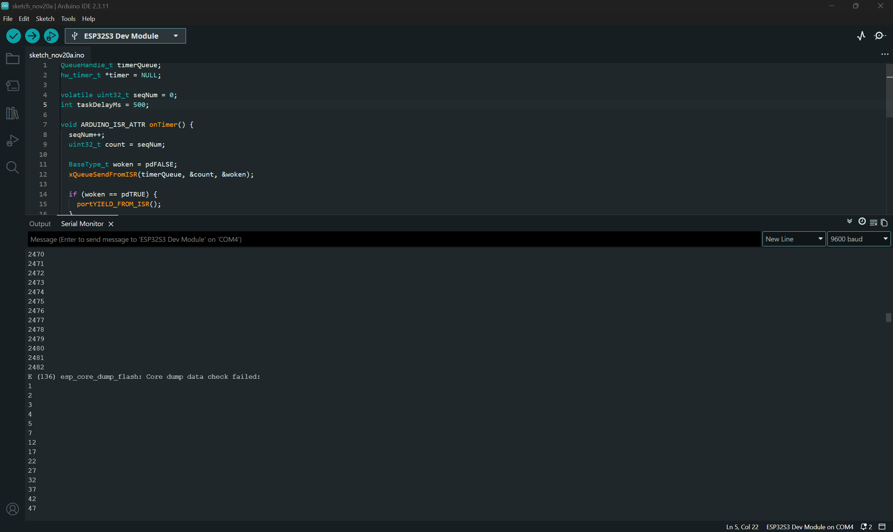

# Assignment 9: Hardware Timer ISR to FreeRTOS Queue

Used an ESP32-S3-DevKitC-1 v1.1 over USB on COM4 (no external wiring needed) in Arduino IDE 2.x at 115200 baud. Set up a 1 MHz hardware timer with an auto-reload alarm every 100,000 ticks (100 ms), sending an incrementing `uint32_t` sequence number from the ISR into a 4-slot FreeRTOS queue (`xQueueSendFromISR`).



## Prediction Before Run B
Before running Run B (500 ms task delay), I predict the 4-slot queue will fill up and drop events. Since the timer interrupt fires every 100 ms while the consumer task waits 500 ms after reading each item, 5 new interrupts happen during every task delay. Once the 4 queue slots are full, new sequence numbers will be dropped until the task wakes up and frees a slot.

## Run Outputs

### Run A (20 ms consumer delay)
The consumer task takes 20 ms per item, which is much faster than the 100 ms interrupt period. Every number arrived in order with no gaps (excerpt from the end of Run A):

```text
2470
2471
2472
2473
2474
2475
2476
2477
2478
2479
2480
2481
2482
```
### Run B (500 ms consumer delay)
```
1
2
3
4
5   <-- last buffered item before first gap
7   <-- first observed gap (6 was dropped)
12
17
22
27
32
37
42
47
```
